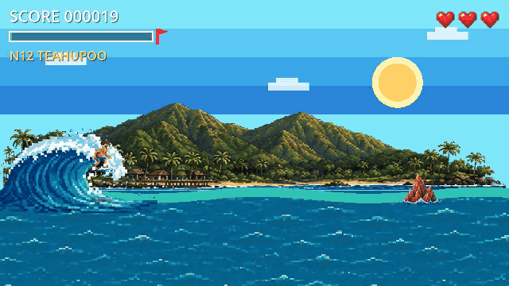
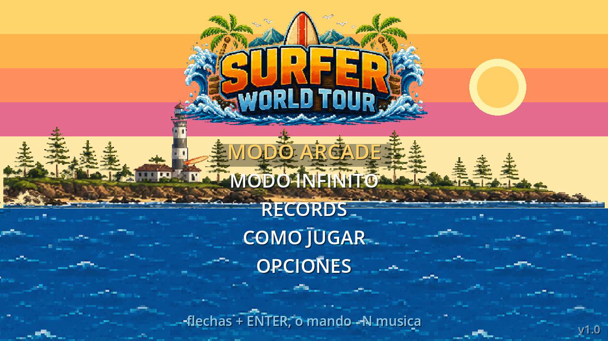
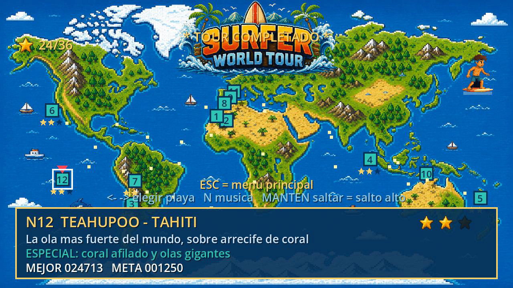
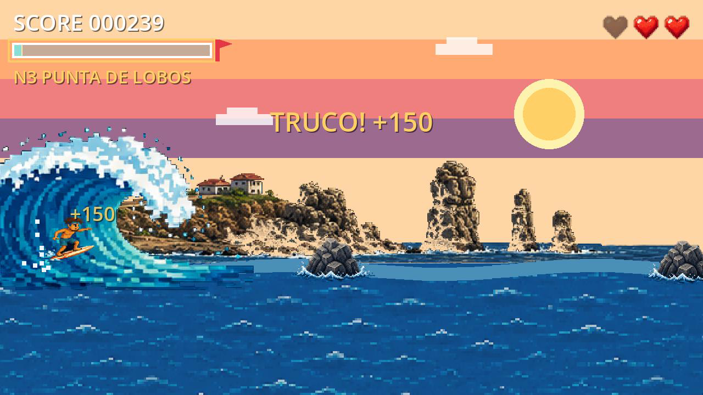
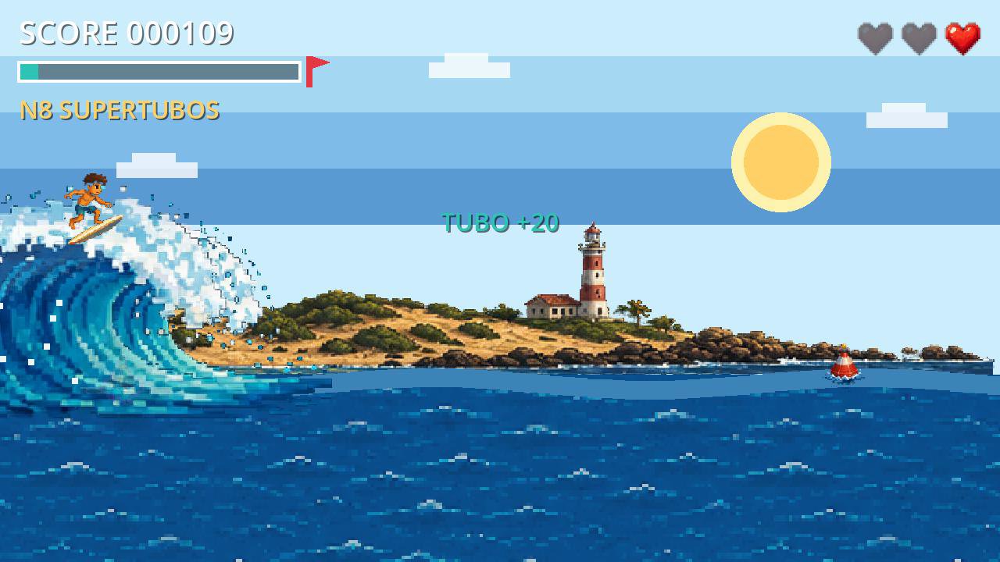

# 🏄 SURFER World Tour

> ⚠️ **Prototipo.** Este repositorio muestra una versión en desarrollo del juego con fines de portafolio. La versión final (contenido, arte y balance definitivos) no forma parte de este repositorio.

Juego arcade de surf en 2D, estilo pixel-art, hecho en **Godot 4.6** con **GDScript**. El jugador recorre un tour mundial por **12 playas reales** (Teahupoo, Pipeline, Hossegor, Uluwatu, Mundaka, Supertubos, Arica, Gold Coast, Malé, Punta de Lobos, Taghazout y Corralejo). Cada playa tiene su propia mecánica, sus obstáculos, su música y un jefe final.

### 🎮 [Juega la demo en el navegador (itch.io)](https://ivanriveraf.itch.io/surfer-world-tour)

  

| Pantalla de título | Mapa del tour mundial |
|---|---|
|  |  |
| **Punta de Lobos, Chile:** trucos aéreos | **Supertubos, Portugal:** bonus por quedarse en el tubo |
|  |  |

## Características

- **Mapa mundial** con 12 playas desbloqueables y guardado automático del progreso.
- **Modo campaña** con 3 estrellas por playa y **modo infinito** con dificultad creciente y ranking local estilo arcade.
- **Control de surf:** remada y *pop-up*, salto variable, doble salto, *jump buffer* y gravedad en tres zonas.
- **Trucos aéreos en combo** y un **sistema de parry al estilo Cuphead**: los obstáculos marcados se pueden reventar en el aire, encadenando multiplicadores.
- **12 jefes con vida y dos fases.** En la segunda fase el jefe acelera y desbloquea un tercer ataque.
- **Power-ups** (escudo, imán y x2) y mini-encuentros con rivales a mitad de cada playa.
- **Soporte completo para mando o gamepad**, con 11 acciones configurables.
- **22 efectos de sonido sintetizados por código**, sin archivos de audio.
- **Sensación de juego:** *squash & stretch*, *hitstop*, *screen shake* y sombra de aterrizaje.

## Tecnologías

Godot 4.6 · GDScript · Pixel-art 320×180 escalado a 1280×720

## Cómo abrirlo

1. Descarga [Godot 4](https://godotengine.org/download) (versión estándar, no .NET).
2. En Godot, haz clic en **Importar** y elige el archivo `project.godot`.
3. Presiona **F5** para jugar.

> La música original del juego no se incluye en el repositorio porque es de terceros. El juego funciona sin ella.

## Controles

| Tecla | Acción |
|---|---|
| ← → | Elegir playa / trucos en el aire |
| Enter | Entrar a la playa |
| Espacio / ↑ | Saltar |
| P | Pausa |
| M | Volver al mapa |
| N | Música on/off |

## Créditos

- Desarrollo, diseño y programación: **Iván Rivera** ([GitHub](https://github.com/ivanriveraf) · [LinkedIn](https://linkedin.com/in/ivan-patricio-rivera-fuentealba))
- Addon [GodotDualsense](addons/GodotDualsense) (licencia MIT)
- Música: pistas de surf rock de Pixabay (no incluidas en el repositorio)

## Licencia

© 2026 Iván Rivera. Todos los derechos reservados. Ver [LICENSE](LICENSE).
