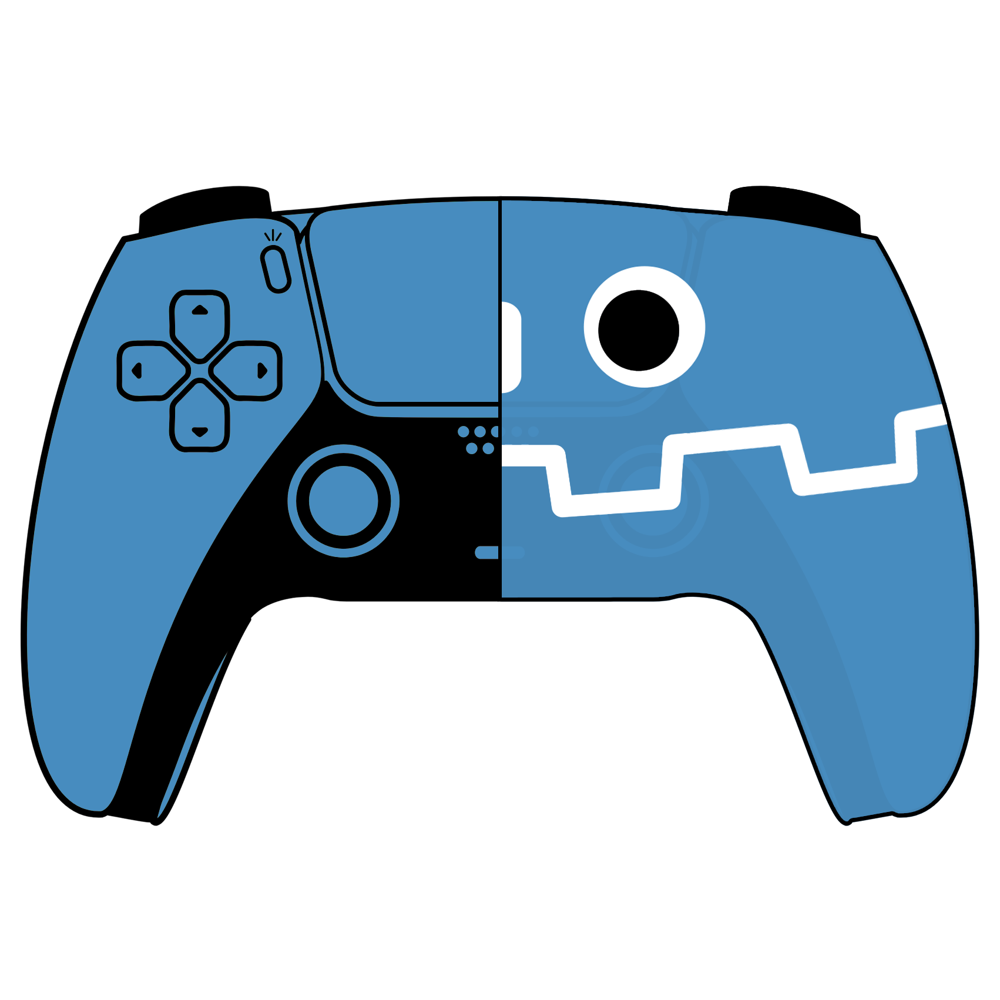

<p align="center"></p>

# DualSense (Godot 4, C#)

Raw HID DualSense support for Godot's built in `Input` gap: adaptive triggers,
lightbar, player LED, mic LED, touchpad, and gyro/accelerometer/battery.
Standard buttons/sticks/rumble already work through Godot's normal `Input`
API (SDL3 backend); this addon only owns the parts SDL doesn't expose, and
it talks to the controller directly, no DualSenseX or other background app
required.

## Install

1. Copy `addons/GodotDualsense/` into your project.
2. Add the NuGet dependency to your `.csproj`:
   ```xml
   <ItemGroup>
     <PackageReference Include="HidSharp" Version="2.1.0" />
   </ItemGroup>
   ```
3. Enable the plugin in Project Settings > Plugins (this registers the
   `DualSenseManager` autoload for you). If you would rather not use the
   Plugins panel, you can register it by hand instead: add
   `DualSenseManager="*res://addons/GodotDualsense/DualSenseManager.cs"` under
   `[autoload]` in `project.godot`, and leave the plugin disabled.

## Usage

### Direct API (code)

For one-off feedback (UI cues, hit reactions, menu polish) call the
autoload straight from a script:

```csharp
DualSenseManager.Instance.SetLightbar(Colors.Red);
DualSenseManager.Instance.SetTriggerResistance(startZone: 2, strength: 200, DualSenseHand.Right);
var touch = DualSenseManager.Instance.State.TouchPosition;
```

`Instance` is `null` until a controller connects and can go `null` again on
disconnect, so always guard with `?.` or check `IsControllerConnected` first.
Every input field (sticks, triggers, touchpad, gyro/accel, battery, all
buttons) lives on `DualSenseManager.Instance.State`, a `DualSenseInputState`
snapshot refreshed every physics frame.

Avoid also calling `Input.start_joy_vibration` while using this addon's
`SetRumble`; both would fight over the same HID output report.

### Binding DualSense inputs to actions (no code, editor only)

For anything that should drive actual gameplay ("hold L2 to aim", "tap the
touchpad to dash"), don't poll `State` from gameplay scripts. Instead wire it
through `Bindings/`, which turns a DualSense input into a normal Godot input
action via `Input.ActionPress`/`ActionRelease`. The rest of the game (state
machines, `Input.IsActionJustPressed`, etc.) never has to know a DualSense
was involved, and keyboard/other controllers keep working unaffected.

1. **(Optional) Create a trigger profile**, only needed if you want the
   physical trigger to feel like something. Right click in the FileSystem
   dock, choose *New Resource* > `DualSenseTriggerProfile`, save it as a `.tres`,
   then in the Inspector pick an `Effect Type` (Resistance, Bow, Galloping,
   Weapon, MachineGun, Machine, GameCube, or Off) and tune its parameters.
2. **Create a binding**: *New Resource* > `DualSenseActionBinding`, save it
   as a `.tres`. Set:
   - `Action`: the Godot input action name to drive (must already exist in
     `Project Settings > Input Map`, e.g. `"dash"`).
   - `Source`: what to read: `LeftTriggerAnalog`/`RightTriggerAnalog`
     (0-1 pull), `TouchpadTouching`, or any digital button, including ones
     Godot's `Input` can't reach at all, like `Mute`, `PS`, `Fn1`/`Fn2`,
     `PaddleLeft`/`PaddleRight` (DualSense Edge).
   - `Threshold`: for the analog trigger sources, how far it must be
     pulled (0-1) to count as "pressed". Ignored for digital sources.
   - `TriggerProfile`: optional; only applies when `Source` is a trigger.
3. **Add the binder**: add a plain `Node` anywhere in your scene, attach
   `DualSenseActionBinder.cs` as its script, and drop your binding
   resource(s) into its exported `Bindings` array. It applies each
   binding's trigger profile once on connect, then drives the action every
   physics frame while the controller is connected.

## Testing status

Version 0.1. See [TESTING.md](../../TESTING.md) at the repository root for
what has been confirmed against real hardware and what has not.

## Credits / License

MIT, see [LICENSE](LICENSE). The HID protocol implementation under
`Protocol/` (input parsing, output composition, CRC32, adaptive-trigger
encoding) is a C# port of Rafael Valoto's
[Dualsense-Multiplatform](https://github.com/rafaelvaloto/Dualsense-Multiplatform)
(MIT).
